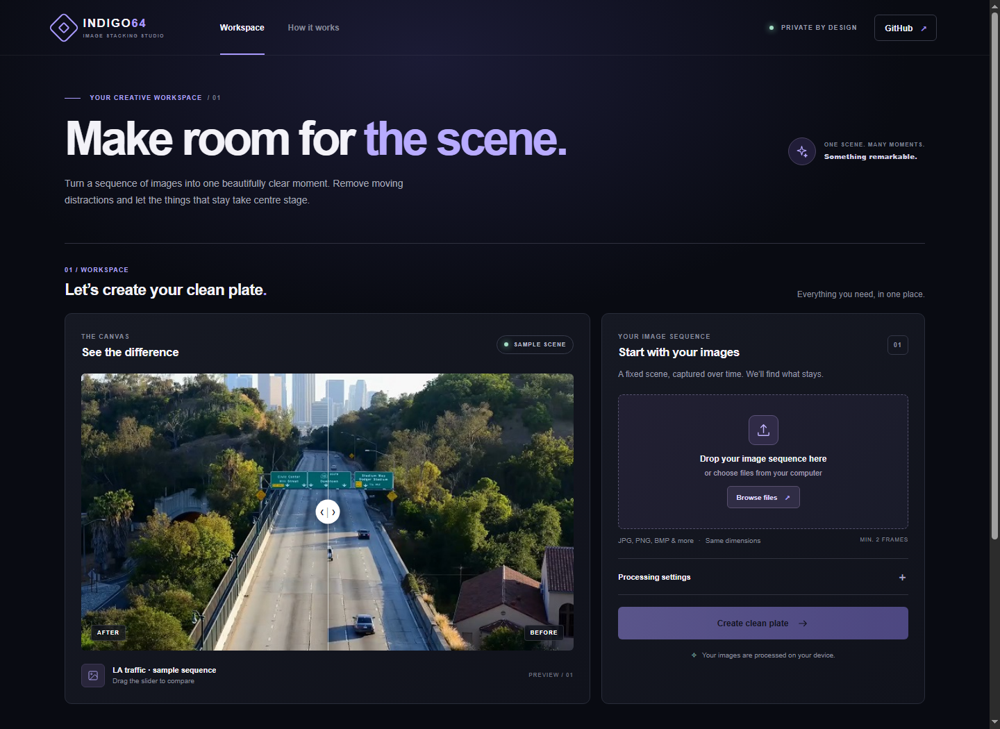

# Indigo64

**Create a clean plate from an image sequence, right in your browser.**

Indigo64 combines images of a fixed scene to reveal what stays. It can help remove moving distractions such as people or vehicles, or reduce passing trails in suitable astronomical image sequences.

**[Open Indigo64](https://indigo64.app/)**



## How it works

For each pixel position, Indigo64 looks through the sequence and chooses the most frequently occurring **whole RGB colour**. This is called the *mode*. For example, if a stationary background is visible at a pixel in most frames, its colour can win over a passing object.

```text
Frame 1      Frame 2      Frame 3      Frame 4
  blue         red         blue         blue
    \           |           |           /
         most frequent colour: blue
```

The result depends on the images: moving objects are not guaranteed to disappear, especially if they cover the same position in many frames. If colours tie, the first colour in filename order wins.

## Getting started

1. Photograph the same scene multiple times with a fixed camera. Keep the framing, focus and exposure as consistent as practical.
2. Open [indigo64.app](https://indigo64.app/) and drop in or select at least two images. All images must have the same dimensions and should already be aligned.
3. Choose **Create clean plate**. Under **Processing settings**, you can choose Automatic, CPU or WebGPU, and adjust the strip working-memory target.
4. When processing finishes, download the resulting PNG.

The example comparison on the page uses an LA traffic sequence. The workspace displays preparation and processing progress and lets you cancel a job.

## Processing and privacy

- Your selected images are processed on your device, rather than uploaded for image processing. The website itself is served over the internet and currently loads fonts from Google.
- **Automatic** tries WebGPU and falls back to CPU processing if GPU processing is unavailable or fails. Selecting **WebGPU** explicitly reports GPU errors instead. Availability and speed depend on the browser, graphics hardware and driver.
- Decoded frames are stored temporarily in the browser's private storage and processed in horizontal strips. Temporary data is removed on completion, cancellation or handled errors; an unexpected browser or process shutdown may leave it behind.
- The working-memory setting is a target for strip data, not a limit on total memory. Browser storage quotas, available memory and device limits can prevent large stacks from completing even when the disk has free space.
- Images are decoded by the browser. JPG, PNG and BMP support depends on the browser; TIFF and other formats are not guaranteed. The processor works with 8-bit RGB, ignores transparency and produces an opaque PNG. Image alignment and preservation of higher bit depths are not currently provided.

Indigo64 uses the separate [Mode Stack Processing library](https://github.com/Rod-Vadar/mode-stack-processing), which provides browser JavaScript and native C++ APIs. The library is still experimental.

## Run locally

With Node.js installed:

```sh
npm install
npm start
```

Open [http://localhost:3000](http://localhost:3000). To make a production build, run `npm run build`; to run the tests, use `npm test -- --watch=false`. The browser file-processing path requires a secure context (HTTPS or localhost) and browser support for its image and temporary-storage APIs.

## Background

Indigo64 grew out of the need to create clean plates for visual effects and explore removing transient objects from image sequences, including astronomical observations. The project began as an experiment in counting pixel colours and evolved into a browser workspace backed by a reusable mode-stacking library.

The author's [original project notes](docs/original-project-notes.md) are preserved as a historical account of the earlier version.
